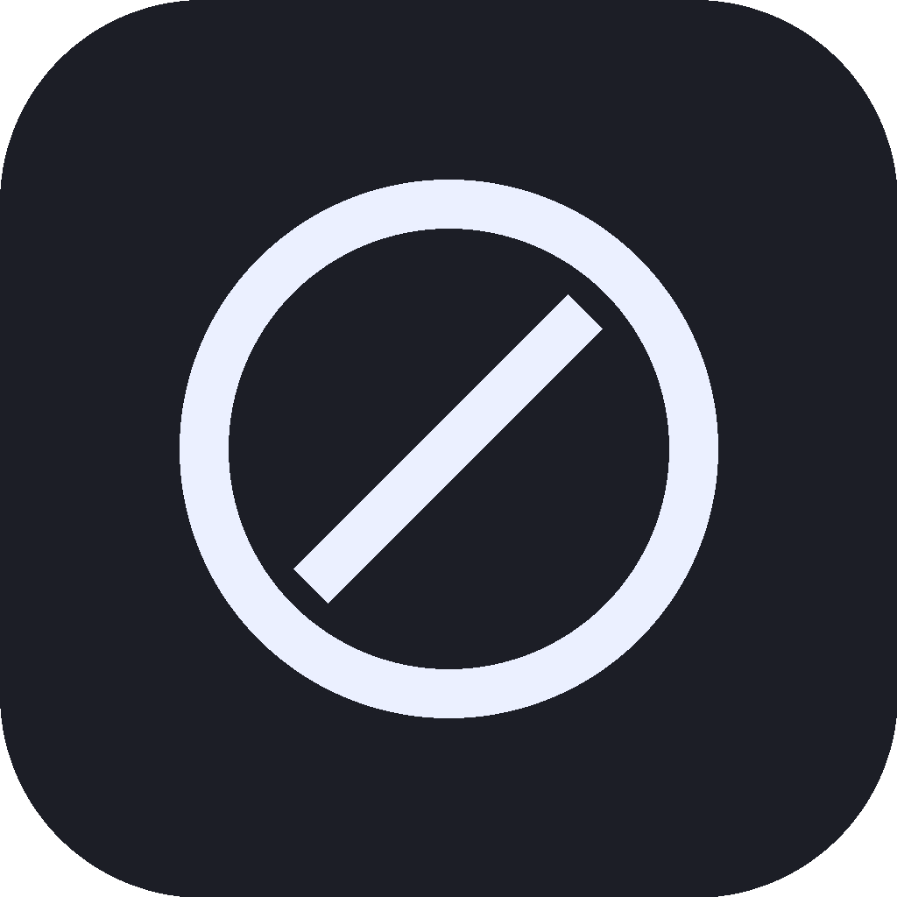

# WorkBuddy 更新屏蔽器 / WorkBuddy Update Blocker

> 一款 macOS 原生的 WorkBuddy 强制更新屏蔽工具。**首选方案：锁定更新缓存目录权限 + 清理待装更新包**（不改 hosts、无副作用）；**备用方案：`/etc/hosts` 屏蔽更新下载域名 + 开机守护**。
> A native macOS tool that blocks WorkBuddy's (Tencent Electron) forced auto-update. **Preferred: lock the update cache directories + purge pending update packages** (no hosts change, no side effects). **Fallback: block the update download domain via `/etc/hosts` + a LaunchDaemon guard.**

> **作者 Author：banqiu**
> **许可证 License：MIT**（详见 LICENSE）。可自由使用、修改与再分发，须保留版权与许可声明。

<p align="center"></p>

[下载最新版 / Download](https://github.com/hwl513782273/WorkBuddyUpdateBlocker/releases/latest) · [问题反馈 / Issues](https://github.com/hwl513782273/WorkBuddyUpdateBlocker/issues)

---

## 中文

### 用哪个方案？（推荐顺序）

| 顺序 | 方案 | 说明 |
|---|---|---|
| **① 首选** | **目录锁 + 待装包清理** | 把更新缓存 `downloads/`、`extracted/` 权限设为 `000`，并清掉已下载的包与安装状态文件。**不改 `/etc/hosts`、不装守护、不影响技能市场等 CDN 资源**，可随时一键解除。 |
| ② 备用 | 域名屏蔽 + 开机守护 | 仅当目录锁失效（例如腾讯改了缓存路径）再用：把 `download.codebuddy.cn` 解析到 `0.0.0.0`，可选装 LaunchDaemon 每 5 分钟补回 hosts。副作用：同一 CDN 上的技能市场图标等可能加载不出。 |

### 主要功能

**首选：目录锁 + 待装包清理**
- **自动跟随 WorkBuddy 版本与 bundle id**：读取 `/Applications/WorkBuddy.app/Contents/Info.plist` 动态推导缓存目录（5.9.x 起 bundle id 为 `com.tencent.workbuddy.mac`，旧版 `com.workbuddy.workbuddy` 同样兼容），不再写死路径。
- **首次安装也能用**：若这台机器从未更新过、`~/Library/Caches/<bundleid>.BundleMigration/{downloads,extracted}` 还不存在，点「启用目录锁」会**先自动创建缺失目录再上锁**，不会把 `chmod 000` 打在空气上。
- **真实状态回读**：锁定后用 `stat -f %A` 逐个回读两个目录，只有确实是 `000` 才显示绿灯；失败会明确报出 `downloads:失败 / extracted:失败`，不再「点了就算成功」。
- **清理待装更新包**：清空 `downloads/`、`extracted/`，并移除 `pending-update.json`、`install-in-progress.json`、`/Applications/.WorkBuddy.app.installing.*` 暂存目录 —— 全部移入废纸篓（可恢复）。**目录处于锁状态时会先临时解锁 → 清理 → 自动锁回**。检测到 WorkBuddy 正在安装（`phase=installing` 且进程存活）时拒绝执行。

**备用：域名屏蔽 + 开机守护**
- 一键启用 / 禁用 `/etc/hosts` 屏蔽 `download.codebuddy.cn`（系统密码框授权）。
- 可选安装系统级 LaunchDaemon 守护：每 5 分钟检查 hosts，被 Adobe 类工具整份重写后自动补回；「关闭守护并还原」一步卸载守护 + 删除脚本 + 移除屏蔽段。

**通用**
- **检查更新缓存目录**：在 Finder 打开缓存目录，并弹窗列出 `downloads / extracted / backups` 三类内容与当前目录锁、域名屏蔽、守护状态。
- **手动备份更新包**：把下载目录里新的 `.zip` 备份到指定文件夹（重复包移入废纸篓），与目录锁互斥。
- **重启 WorkBuddy** 一键生效。
- 原生 SwiftUI 单文件 App，拖入「应用程序」即用，**正常使用下无常驻后台进程**。

### 快速开始

1. 在 Releases 下载对应系统的 DMG（见下方「macOS 版本选择」）。
2. 打开 DMG，把 `WorkBuddy更新屏蔽器.app` 拖入「应用程序」。
3. 首次打开：右键 → 打开（或终端执行 `xattr -dr com.apple.quarantine "/Applications/WorkBuddy更新屏蔽器.app"`）。
4. **推荐流程**：点「① 启用目录锁（首选）」→ 若状态行提示还有待装包，再点「② 清理待装更新包」→ 点「重启 WorkBuddy」。
5. 需要恢复更新能力时点「解除目录锁」即可（也可用「关闭守护并还原」把备用方案一并清零）。

从源码构建（需 macOS 11+ 与 Swift 工具链）：

```bash
swiftc -O -parse-as-library -framework SwiftUI -framework AppKit -framework Cocoa -framework Combine \
  main.swift -o "WorkBuddy更新屏蔽器.app/Contents/MacOS/WorkBuddy更新屏蔽器"
codesign --force --deep --sign - "WorkBuddy更新屏蔽器.app"
```

### macOS 版本选择
- **Apple Silicon（M1 及更新）**：下载 `11.0-WorkBuddyUpdateBlocker-1.19-arm64.dmg`（纯 arm64，macOS 11.0+）。
- **Intel（x86_64）**：下载 `12.0-WorkBuddyUpdateBlocker-1.19-x86_64.dmg`（macOS 12.0+）。

> 发行版 DMG 为 ad-hoc 签名、**未公证（notarized）**，首次打开请右键「打开」放行 Gatekeeper。命名格式：`支持最低版本-软件名-版本-架构`。

### 工作原理

**① 目录锁（文件系统层，首选）**
WorkBuddy（Electron + electron-updater）把更新包下载到 `~/Library/Caches/<bundleid>.BundleMigration/downloads/`，解压到 `extracted/`，再写 `pending-update.json`、`install-in-progress.json`，最后把 App 暂存到 `/Applications/.WorkBuddy.app.installing.<版本>` 并覆盖安装。把 `downloads/` 与 `extracted/` 权限设为 `000` 后，写入与解压都失败，更新链条从源头断掉；再配合清理上述状态文件与暂存目录，已下载的包也不会在下次启动时被装上。

**② 域名屏蔽（网络层，备用）**
更新包实际下载自 `download.codebuddy.cn`（2026-10 实测；「检查更新」接口走主站 `www.workbuddy.cn/v2/update`，不屏蔽，避免影响在线文档 / 空间）。把它解析到 `0.0.0.0` 即可阻断安装包下载；AI / 账户后端走其他域名，核心功能不受影响。

**为什么不只用内置开关**：WorkBuddy 有 `DISABLE_AUTOUPDATER` 环境变量，但 `launchctl setenv` 在 macOS 上无法注入到已运行的 GUI 会话进程，因此改用上述文件系统 / 网络层方案。

### 差异化亮点
- 🎯 **主次分明**：界面左侧即首选方案（目录锁 + 清理）并标注「优先推荐」，域名屏蔽 + 守护收进右侧「备用」，不再引导用户先动系统 hosts。
- 🛡 **双保险但不必都开**：目录锁单独即可阻断；需要时再叠加域名屏蔽与守护。
- 🧬 **跟随版本自动适配**：bundle id / 缓存路径动态探测，WorkBuddy 换 ID 也不用等新版工具。
- 🪄 **首次安装零障碍**：缺失目录自动创建后上锁，避免旧版「静默失效」。
- 🧰 **图形化一键操作**：启用 / 解除锁、清理待装包、检查目录、重启 WorkBuddy，全程按钮。
- 🔒 **全本地、零上传**：所有操作在本机完成。
- ♻️ **可恢复**：清理一律走废纸篓；解除锁 / 关闭守护都会还原权限与 hosts。

### 已知限制
- 若腾讯改变更新机制（更换缓存路径 / 域名 / bundle id 命名规则），需相应更新本工具；界面会显示「未完全锁定」等真实状态，便于判断。
- 备用方案（域名屏蔽）的副作用：技能市场、头像等走 `download.codebuddy.cn` 的资源可能加载不出，临时禁用即可恢复。
- 发行版未公证，首次打开请右键「打开」；Apple Silicon 请勿使用 Intel 版。

---

## English

### Which mode should I use?
1. **Preferred — Directory lock + pending-package purge**: sets `downloads/` and `extracted/` under `~/Library/Caches/<bundleid>.BundleMigration/` to mode `000` and removes downloaded packages plus install-state files. No `/etc/hosts` edits, no daemon, no CDN side effects; fully reversible.
2. **Fallback — Domain block + LaunchDaemon guard**: resolve `download.codebuddy.cn` to `0.0.0.0` and optionally install a LaunchDaemon that re-adds the hosts block every 5 minutes. Side effect: other resources on the same CDN (skill marketplace icons, avatars) may not load.

### Highlights
- **Follows the installed app**: derives the cache path from `/Applications/WorkBuddy.app/Contents/Info.plist`, so the new bundle id (`com.tencent.workbuddy.mac`, 5.9.x+) and the legacy one both work.
- **Works on a fresh install**: if `downloads/` / `extracted/` do not exist yet, they are created first and only then locked.
- **Verified state**: after locking, both directories are re-read via `stat -f %A`; the UI only shows green when the mode really is `000`.
- **Purge covers 5 kinds of leftovers**: `downloads/*`, `extracted/*`, `pending-update.json`, `install-in-progress.json`, `/Applications/.WorkBuddy.app.installing.*` — all moved to Trash (recoverable). If locked, it unlocks temporarily, purges, then re-locks.
- **Check cache / manual backup / restart WorkBuddy** are one click each.
- Native SwiftUI single-file app, no dependencies, no background process in normal use.

### Quick start
1. Download the DMG for your Mac from Releases.
2. Drag `WorkBuddy更新屏蔽器.app` into Applications.
3. First launch: right-click → Open (or `xattr -dr com.apple.quarantine "/Applications/WorkBuddy更新屏蔽器.app"`).
4. Click **① 启用目录锁（首选）** → if pending packages are reported, click **② 清理待装更新包** → **重启 WorkBuddy**.
5. To restore updating, click **解除目录锁**.

### Choose a build
- **Apple Silicon**: `11.0-WorkBuddyUpdateBlocker-1.19-arm64.dmg` (macOS 11.0+).
- **Intel**: `12.0-WorkBuddyUpdateBlocker-1.19-x86_64.dmg` (macOS 12.0+).

> Release DMGs are ad-hoc signed and **not notarized**; right-click "Open" on first launch.

### How it works
- **Directory lock (filesystem)**: electron-updater stores packages in `downloads/`, extracts into `extracted/`, writes `pending-update.json` / `install-in-progress.json`, stages the app at `/Applications/.WorkBuddy.app.installing.<version>`. Mode `000` on the two directories blocks the write and the extraction.
- **Domain block (network, fallback)**: the package host `download.codebuddy.cn` is resolved to `0.0.0.0`; the update-check endpoint lives on the main site and is intentionally left alone.

### Known limitations
- If Tencent changes the update mechanism (cache path, domain, bundle id scheme), the tool needs an update; the UI reports real lock state so failures stay visible.
- The fallback domain block may break non-core CDN resources such as marketplace icons.
- Not notarized; right-click "Open" on first launch.

---

## 隐私与安全 / Privacy and security
- 纯本地运行，不上传任何数据。
- 写 `/etc/hosts` 与修改目录权限均在本机完成；写入 hosts 会弹系统密码框授权，所执行操作在界面提示区透明可见。
- 应用未公证（notarized），请仅从本仓库 Releases 获取，并在首次打开时右键放行。

---

## 许可证 / License
**MIT License** — 版权归 **banqiu** 所有（2026）。
- 允许个人与商业免费使用、修改、再分发，须保留版权与许可声明。
- 完整条款见 [LICENSE](LICENSE)。

---

## 支持 / Support
WorkBuddy 更新屏蔽器是一款免费开源工具，基于 MIT 许可发布。如果你觉得好用，欢迎在 GitHub 上点个 Star，或反馈问题 / 提交 PR。
